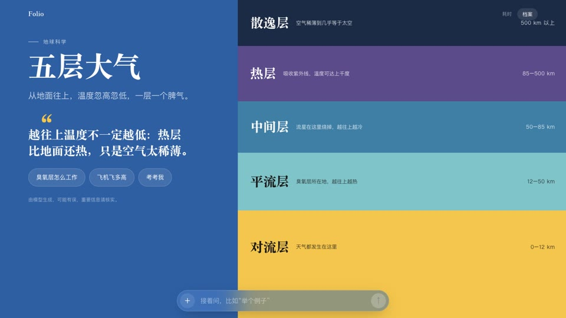
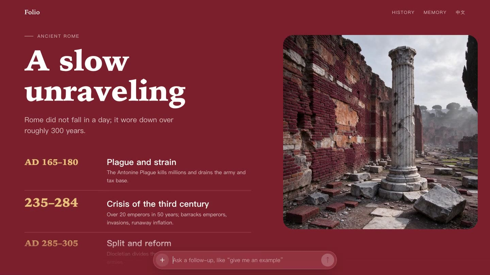
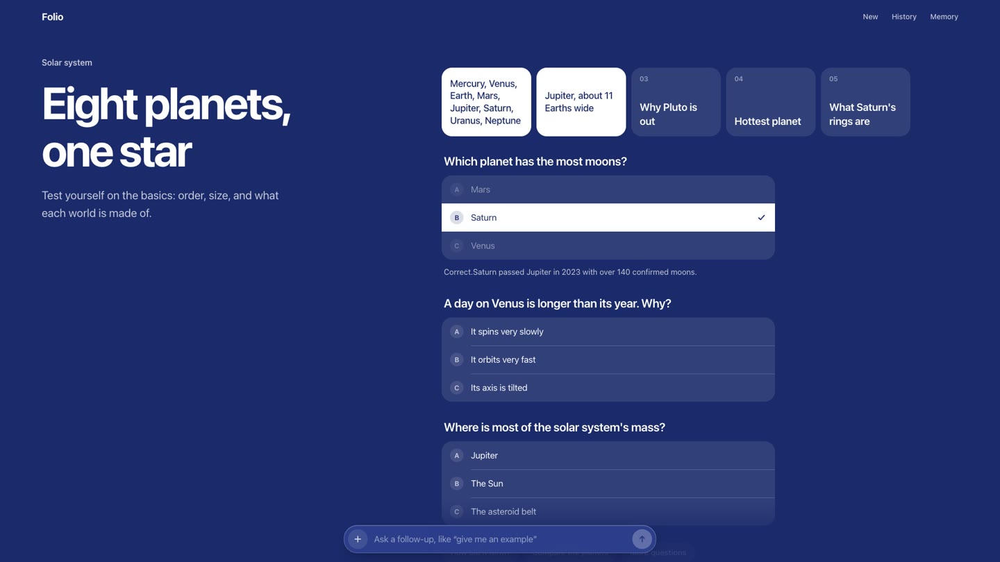

# Folio

**English** · [简体中文](README.zh-CN.md)

Ask anything. Get a page.

Folio answers a question with a page instead of a chat message. The layout, colors, type and pictures are composed on the spot to fit what you asked, and no two questions get the same page.

https://github.com/user-attachments/assets/91c23648-41f3-4152-ad6c-b30a5b7a7ef1

A 75-second tour with narration and captions. It is a recording of the real app; the waits for pictures are cut short, as the caption strip says. If the player does not load, the file is at [`docs/demo.mp4`](docs/demo.mp4).

| Two things compared | Something with layers | A stretch of history |
|---|---|---|
|  |  |  |

| Flashcards and a quiz | A picture you took | Every page is kept |
|---|---|---|
|  |  |  |

## What it does

- **A different page for every question.** One subject, two things compared, layers, a timeline, a process, a study plan, a set of pictures: each gets its own layout.
- **Pages you can use, not just read.** Flip a flashcard, answer a quiz, or tap any part of a page to go deeper.
- **Pictures say what they show.** When a page shows several things, each picture shows one of them and carries its name.
- **Ask about a picture.** Attach a photo of an object, a homework problem or a chart, or paste or drop one anywhere on the page. Folio works out what it is and builds the page around it.
- **It remembers you.** Say "I'm in ninth grade" or "use more analogies" once, and later pages follow. You can see and delete what it remembers under Memory.
- **Nothing gets lost.** Follow-ups keep the earlier pages, and the back button leafs through them. Every conversation is saved with its pictures and has its own address (`/c/…`), so you can reload it, bookmark it, or reopen it from History later, on any device.
- **English and Chinese.** The interface follows your browser language and can be switched in the header. Each page is written in the language you ask in.

Pages are written by an AI model and can be wrong. Check anything important.

## Run it

You need Docker and an API key for [Volcengine Ark](https://www.volcengine.com/product/ark), the model service Folio runs on.

```sh
git clone https://github.com/Lewin671/folio.git && cd folio
cp .env.example .env        # open .env and fill in ARK_API_KEY
docker compose up -d
```

Then open <http://localhost:8787>.

### Getting a Volcengine Ark key

Volcengine is ByteDance's cloud. Its console is in Chinese, so the Chinese names of the two pages you need are given below.

1. In the [Ark console](https://console.volcengine.com/ark), create a key under **API Key 管理** (API Key Management).
2. Under **开通管理** (Model Activation), activate the three models below. You can point Folio at other models with the environment variables.

| Used for | Variable | Default |
|---|---|---|
| Layout and writing | `TEXT_MODEL` | `deepseek-v4-1-flash-261017` |
| Pictures | `IMAGE_MODEL` | `doubao-seedream-5-0-flash-260915` |
| Reading attached pictures | `VISION_MODEL` | `doubao-seed-2-0-mini-260428` |

If the key is wrong or a model is not activated, the home page says what is missing. `docker compose logs` shows the same message.

Each page costs one call to the text model and up to four pictures; a question with an attached picture adds one vision call. Volcengine bills these to your account.

### Other settings

| Variable | Default | What it does |
|---|---|---|
| `BIND` | `127.0.0.1` | Address to listen on. Set `0.0.0.0` to reach it from your phone on the same network; read the security notes first. |
| `PORT` | `8787` | Port on your machine. |
| `NPM_REGISTRY` | npm's own | Registry used while building the image. In mainland China, `https://registry.npmmirror.com` is faster. |

These are read by `docker compose`. Put them in `.env` or in front of the command.

## Privacy and security

- Memory, your pages, the generated pictures and the pictures you attach are stored only on the machine running Folio, in the Docker volume `folio-data`. You can delete them under History and Memory. Memory is sent to the model with every question; an attached picture is sent to Volcengine's models for that question.
- **There is no login.** Anyone who can open the address can read and delete your history and memory, and spend your key. By default Folio only listens on your own machine. Open it to a network only if you trust everyone on it, and never expose it to the internet as it is.
- The prompt tells the model not to draw real people and not to identify anyone in a photo. That is an instruction to the model, not something the code enforces.

## How it works

1. **A small language for pages.** The text model writes one JSON object per line. The first line is the scene (layout, tone, stage color, title); each line after it is one block. The full rules are in [`internal/agent/prompt.md`](internal/agent/prompt.md).
2. **Streaming.** The Go server forwards each complete line to the browser over SSE as soon as it arrives, and starts generating a picture for every block that asks for one, in parallel. The first block shows after about 1.5 seconds, the full text after 3 to 4, and pictures after about 10.
3. **Subjects that stand on the page, without cutting them out.** Pictures are generated on a seamless backdrop in the scene color. The server reads the colors along the picture's left and right edges, and the page paints the same colors at the same heights ([`internal/agent/sample.go`](internal/agent/sample.go)). Pictures of places have no backdrop and are shown in a frame instead.
4. **Layout follows content.** The browser picks a composition from the blocks that actually arrive, so whatever combination the model writes has a place to go.
5. **Follow-ups.** The model writes the whole page again and reuses block ids, so the page changes in place. A picture can be kept, or edited from the previous one.
6. **Attached pictures.** The text model cannot see, so a vision model first describes the picture in words, and the text model lays out the page from that. The picture itself is placed on the page as it is.
7. **History.** The image service's links expire, so the server keeps a copy of each picture when it reads its colors. After each page, the browser hands the conversation to the server to store ([`internal/library`](internal/library/library.go)). Every page is also a browser history entry with its own address (`/c/<conversation>/<page>`), which is why the back button, reload and a link opened elsewhere all land on the same page.
8. **Memory.** When you say something lasting about yourself, the model writes a "remember" line. The server stores it, the page shows a notice you can undo, and it is added to the system prompt from then on.
9. **Caching.** Every call starts with the same long system prompt, which Volcengine caches automatically on the Chat API. In testing, 95 to 98 percent of input tokens were read from the cache. The server logs the figure for each page.
10. **Language.** The server decides the page's language from the question and tells the model outright. The prompt itself is written in Chinese, since the default text model follows it best that way.

## Development

You need Go 1.25, Node 22 and pnpm.

```sh
export ARK_API_KEY=...
make build && ./folio         # http://127.0.0.1:8787
make dev                      # in another terminal: front end with hot reload
make test
```

Add `?mock` to the address to see the layouts with built-in sample pages (in Chinese) without calling a model. `?lang=en` or `?lang=zh` forces the interface language, and `?timing` shows how long each stage took and how much of the input was served from the cache.

## Known limits

- **Facts can be wrong.** The prompt asks the model to stick to what it is sure of, but it still makes mistakes and can sound more certain than it should. Nothing is checked against the web.
- Pictures take about ten seconds. The text comes first and a placeholder holds the picture's place. Pictures cannot carry text labels, so there are no annotated diagrams.
- One user per installation.
- Questions in languages other than English and Chinese get an English page.
- Chinese display type uses the system's Songti, which Android does not have; titles fall back to a sans-serif there.

## Credits and license

The idea comes from Google Design's concept film "The Next Interface". Every picture in the demo is AI-generated.

[MIT](LICENSE)
