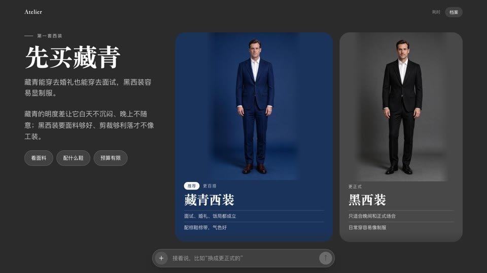
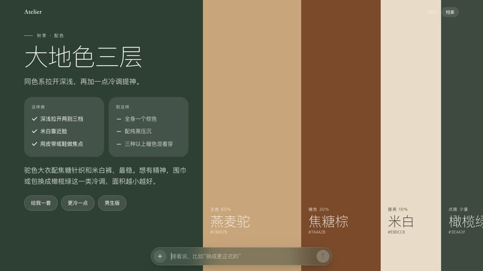
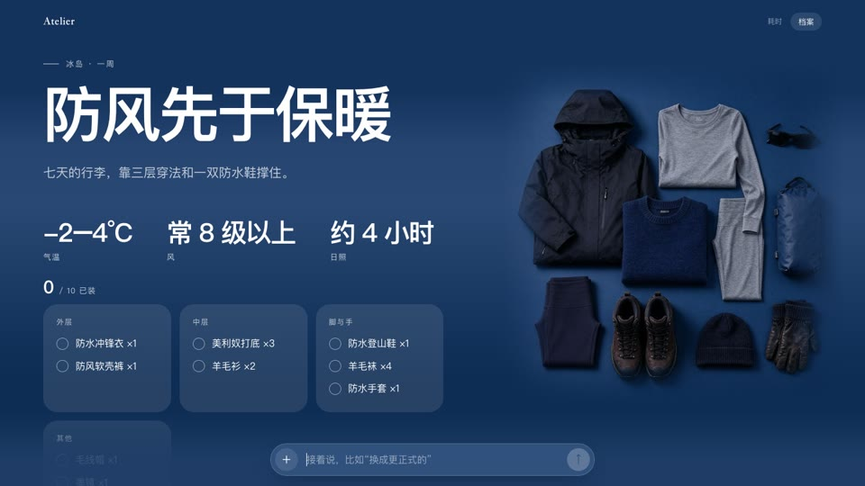
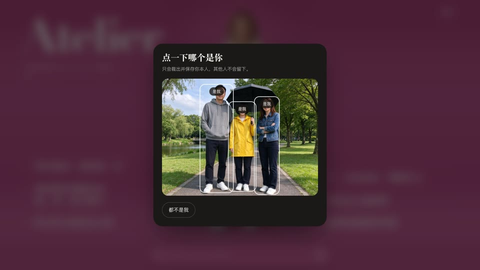

# Atelier

一个会排版的造型助手。你问一句穿搭问题，它不回一段聊天文字，而是现排一页界面：版式、配色、字体气质和图片都按这个问题当场生成。

[](docs/demo.mp4)

▶ [看 90 秒演示视频](docs/demo.mp4)（真实操作录屏；等待出图的部分做了加速，画面右上角有标注）

| 二选一 | 配色 | 清单 |
|---|---|---|
|  |  |  |

| 灵感 | 认出合照里哪个是你 |
|---|---|
|  |  |

## 它能做什么

- **每个问题一页不同的界面**：整套穿搭、二选一、配色、行李清单、方法步骤、风格灵感，各有各的版式。
- **多轮修改**：点清单里的一件单品，只换那一件，人物和其余部分保持不变。
- **穿在你身上**：上传一张自己的照片，之后的穿搭图用你本人做模特。合照里会让你点选哪个是你，只保存你本人。
- **记得你的偏好**：聊天里说过“不穿高跟鞋”“常穿 M 码”，之后的建议会照着来。照片和偏好都可以在档案里查看、删除。

## 运行

需要 Docker 和一个火山方舟的 API Key。

```sh
git clone <本仓库地址> atelier && cd atelier
cp .env.example .env        # 打开 .env，填上 ARK_API_KEY
docker compose up -d
```

然后打开 <http://localhost:8787>。

### 准备火山方舟的 Key

1. 在[火山方舟控制台](https://console.volcengine.com/ark)的「API Key 管理」里创建一个 API Key。
2. 在「开通管理」里开通下面三个模型（可以用环境变量换成别的）：

| 用途 | 环境变量 | 默认模型 |
|---|---|---|
| 排版和文案 | `TEXT_MODEL` | `deepseek-v4-1-flash-261017` |
| 出图 | `IMAGE_MODEL` | `doubao-seedream-5-0-flash-260915` |
| 看照片 | `VISION_MODEL` | `doubao-seed-2-0-mini-260428` |

Key 无效或模型没开通时，首页会直接告诉你缺什么，`docker compose logs` 里也有同样的提示。

每一页会调用一次文本模型和一到三次出图，费用按火山方舟的价格由你的账号承担。

### 其他配置

| 变量 | 默认 | 说明 |
|---|---|---|
| `BIND` | `127.0.0.1` | 监听地址。设为 `0.0.0.0` 可让局域网里的手机访问，见下面的安全说明 |
| `PORT` | `8787` | 本机端口 |
| `NPM_REGISTRY` | 官方源 | 构建镜像时用的 npm 源。国内可设为 `https://registry.npmmirror.com` |

这几个是给 `docker compose` 用的，写在 `.env` 里或放在命令前面都可以。

## 隐私和安全

- 照片和偏好只存在运行它的机器上（Docker 卷 `atelier-data`）。识别照片和生成试穿图时，照片会发给火山方舟的模型。
- **没有登录**。能访问这个地址的人都能看到和修改档案，也会消耗你的 Key。默认只监听本机；如果要开放给局域网，请确认网络里都是你信任的人，不要直接暴露到公网。
- 请只上传你自己的照片。

## 工作原理

1. **界面描述语言**：文本模型按行输出 JSON。第一行是场景（版式、字体气质、舞台色、标题），之后每行一个内容块。完整的规则在 [`internal/agent/prompt.md`](internal/agent/prompt.md)。
2. **流式渲染**：Go 服务每收到完整的一行就通过 SSE 推给浏览器，带出图提示词的块同时并行发起出图。首块约 1.5 秒出现，整页文字约 3 秒，图片约 10 秒。
3. **不抠图也能让人物站在页面上**：图片直接拍在场景色的无缝背景纸上，服务端读取图片左右边缘的颜色，页面按同样的高度铺上这组颜色（[`internal/agent/sample.go`](internal/agent/sample.go)）。
4. **版式由内容决定**：前端按实际到达的块选择构图，模型输出任何组合都有地方放。
5. **多轮**：模型重发整页并沿用块的 id，前端原地变形；图片可以标记为保留，或在上一张的基础上修改。
6. **档案**：视觉模型框出照片里的每个人，由用户确认哪个是本人后才裁剪存档；只有和已确认照片高置信匹配的单人照会自动存入，并且可以撤销（[`internal/agent/photo.go`](internal/agent/photo.go)）。

## 开发

需要 Go 1.25、Node 22 和 pnpm。

```sh
export ARK_API_KEY=...
make build && ./atelier       # http://127.0.0.1:8787
make dev                      # 另开一个终端：前端热更新
make test
```

在地址后加 `?mock` 可以用内置的假数据看各种版式，不调用模型。

## 已知的不足

- 图片要等十秒左右，这段时间页面先出文字，图片位置是占位。
- 换装后人物的脸和发型偶尔会有细微变化。
- 只支持一位用户。
- 中文大标题用的是系统自带的宋体，安卓上没有，会显示成黑体。

## 致谢与许可

界面思路受 Google Design 的概念片 “The Next Interface” 启发。演示里的人物都是 AI 生成的，不是真人。

[MIT](LICENSE)
