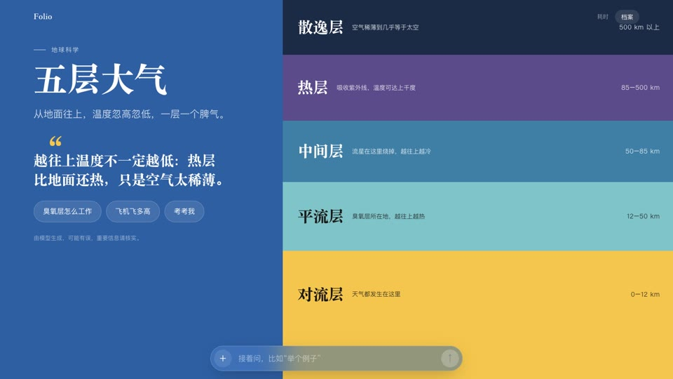
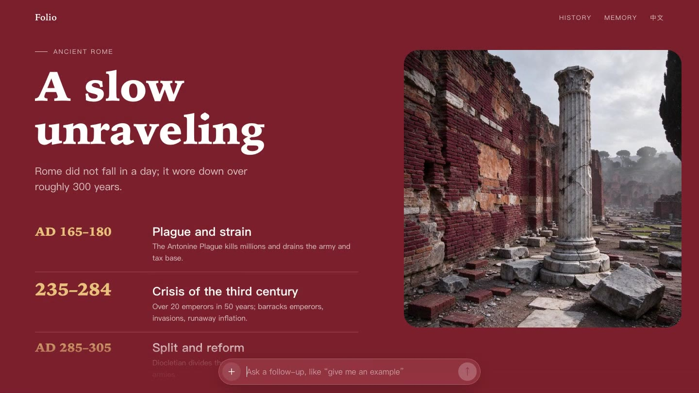
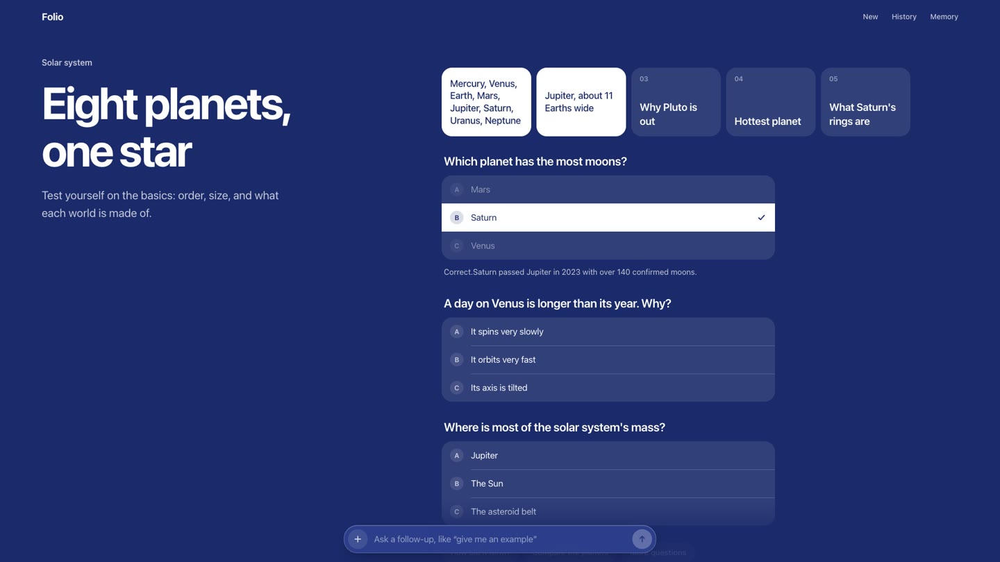
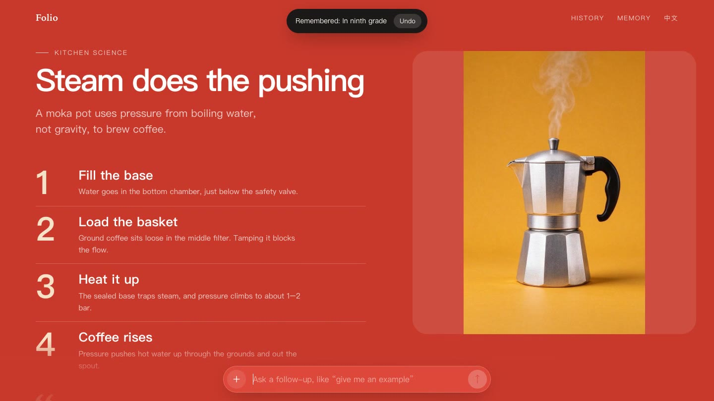
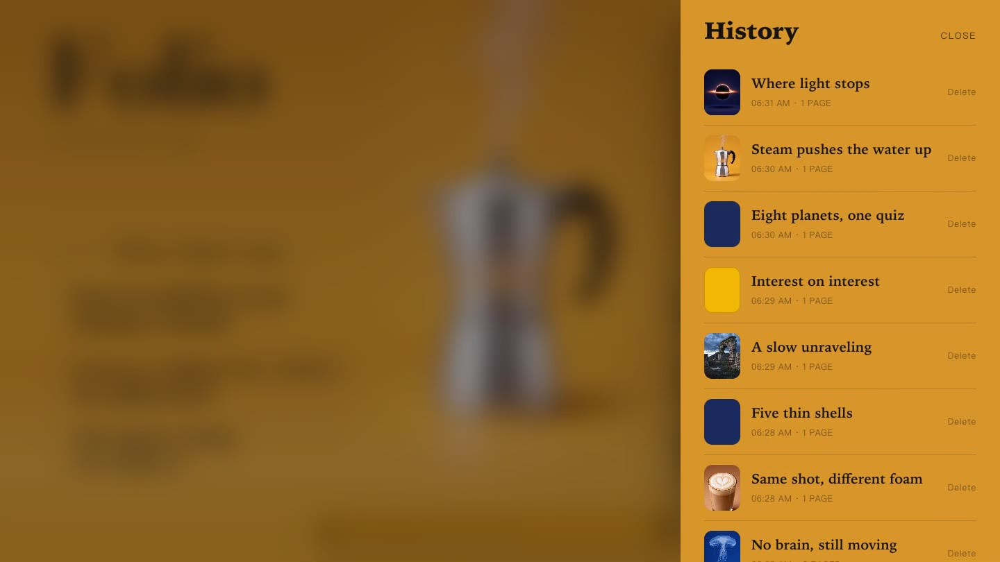

# Folio

[English](README.md) · **简体中文**

问什么，都给你排一页。

Folio 不回一段聊天文字，而是按你的问题现排一页界面：版式、配色、字体和图片都当场生成，每个问题得到的页面都不一样。

https://github.com/user-attachments/assets/91c23648-41f3-4152-ad6c-b30a5b7a7ef1

75 秒的演示，英文旁白加字幕。画面是真实操作的录屏，等待出图的部分剪短了（字幕条上有注明）。播放器加载不出来时，文件在 [`docs/demo.mp4`](docs/demo.mp4)。

| 辨析两个东西 | 有层次的东西 | 一段历史 |
|---|---|---|
|  |  |  |

| 记忆卡和小测验 | 附一张图提问 | 每一页都留着 |
|---|---|---|
|  |  |  |

## 它能做什么

- **每个问题一页不同的界面**：讲一个东西、辨析两个概念、分层结构、历史时间线、原理步骤、学习路线、图集，各有各的版式。
- **能操作，不只是能看**：记忆卡点一下翻面，小测验点选作答，页面上的每个部分都可以点开让它展开讲。
- **图片有说明**：一页里讲好几样东西时，每张图只拍一样，并标上它的名字。
- **附一张图提问**：拍一个东西、一道题或一张图表（也可以直接粘贴或拖进页面），它先看懂，再围绕这张图排一页。
- **记得你是谁**：说过一次“我是初中生”“多用比喻讲”，之后的讲解会照着来。记住的内容可以在「记忆」里查看、删除。
- **不会丢**：追问之后，之前的页面还在，后退键可以翻回去。每段对话连同图片都会保存，并且有自己的地址（`/c/…`），可以刷新、收藏，之后也能从「历史」里重新打开，换一台设备也看得到。
- **中英双语**：界面跟随浏览器语言，可以在页眉切换。用什么语言提问，页面就用什么语言写。

内容由模型生成，可能有误，重要信息请自行核实。

## 运行

需要 Docker 和一个[火山方舟](https://www.volcengine.com/product/ark)的 API Key。

```sh
git clone https://github.com/Lewin671/folio.git && cd folio
cp .env.example .env        # 打开 .env，填上 ARK_API_KEY
docker compose up -d
```

然后打开 <http://localhost:8787>。

### 准备火山方舟的 Key

1. 在[火山方舟控制台](https://console.volcengine.com/ark)的「API Key 管理」里创建一个 API Key。
2. 在「开通管理」里开通下面三个模型（可以用环境变量换成别的）：

| 用途 | 环境变量 | 默认模型 |
|---|---|---|
| 排版和文案 | `TEXT_MODEL` | `deepseek-v4-1-flash-261017` |
| 出图 | `IMAGE_MODEL` | `doubao-seedream-5-0-flash-260915` |
| 看懂附图 | `VISION_MODEL` | `doubao-seed-2-0-mini-260428` |

Key 无效或模型没开通时，首页会直接告诉你缺什么，`docker compose logs` 里也有同样的提示。

每一页会调用一次文本模型和最多四次出图，附图提问会多调用一次视觉模型，费用按火山方舟的价格由你的账号承担。

### 其他配置

| 变量 | 默认 | 说明 |
|---|---|---|
| `BIND` | `127.0.0.1` | 监听地址。设为 `0.0.0.0` 可让局域网里的手机访问，先看下面的安全说明 |
| `PORT` | `8787` | 本机端口 |
| `NPM_REGISTRY` | 官方源 | 构建镜像时用的 npm 源。国内可设为 `https://registry.npmmirror.com` |

这几个是给 `docker compose` 用的，写在 `.env` 里或放在命令前面都可以。

## 隐私和安全

- 记忆、问过的页面、生成的图片和你附的图片都只存在运行它的机器上（Docker 卷 `folio-data`），可以在「历史」和「记忆」里删除。记忆每次提问时会一起发给模型；附的图片在当次提问时发给火山方舟的模型。
- **没有登录**。能访问这个地址的人都能看到和删除历史与记忆，也会消耗你的 Key。默认只监听本机；如果要开放给局域网，请确认网络里都是你信任的人，不要直接暴露到公网。
- 提示词要求模型不生成真实人物的肖像、不识别照片里的人是谁；这是对模型的要求，不是技术上的强制。

## 工作原理

1. **界面描述语言**：文本模型按行输出 JSON。第一行是场景（版式、字体气质、舞台色、标题），之后每行一个内容块。完整的规则在 [`internal/agent/prompt.md`](internal/agent/prompt.md)。
2. **流式渲染**：Go 服务每收到完整的一行就通过 SSE 推给浏览器，带出图提示词的块同时并行发起出图。首块约 1.5 秒出现，整页文字约 3–4 秒，图片约 10 秒。
3. **不抠图也能让主体站在页面上**：图片直接拍在场景色的无缝背景纸上，服务端读取图片左右边缘的颜色，页面按同样的高度铺上这组颜色（[`internal/agent/sample.go`](internal/agent/sample.go)）。实景类的图片没有背景纸，改用圆角画框展示。
4. **版式由内容决定**：前端按实际到达的块选择构图，模型输出任何组合都有地方放。
5. **多轮**：模型重发整页并沿用块的 id，前端原地变形；图片可以标记为保留，或在上一张的基础上修改。
6. **附图**：文本模型看不了图，所以先由视觉模型把图片转成文字描述，再交给文本模型排版；用户的原图直接放进版面。
7. **历史**：图片服务的链接过一段时间会失效，所以服务端在取色时顺手把图片存下来；每排完一页，浏览器把整段对话交给服务端保存（[`internal/library`](internal/library/library.go)）。每一页对应一条浏览器历史记录和一个地址（`/c/<对话>/<页码>`），所以后退、刷新、在别处打开链接，都能回到同一页。
8. **记忆**：模型遇到长期有效的信息时输出一行“记住”，服务端存盘并通知页面显示可撤销的提示，之后每轮都把记忆拼进系统提示词。
9. **缓存**：每次调用都以同一段很长的系统提示词开头，火山方舟在 Chat API 上会自动缓存它。实测 95%–98% 的输入来自缓存，服务端日志里会记下每一页的数字。
10. **语言**：服务端根据问题判断这一页用什么语言，并明确告诉模型。提示词本身用中文写，因为默认的文本模型这样遵循得最好。

## 开发

需要 Go 1.25、Node 22 和 pnpm。

```sh
export ARK_API_KEY=...
make build && ./folio         # http://127.0.0.1:8787
make dev                      # 另开一个终端：前端热更新
make test
```

在地址后加 `?mock` 可以用内置的假数据（中文）看各种版式，不调用模型。`?lang=en` 或 `?lang=zh` 强制界面语言，`?timing` 显示各阶段耗时和输入的缓存命中比例。

## 已知的不足

- **事实可能出错**。提示词要求只讲有把握的内容，但模型仍会讲错或讲得过于肯定，没有联网核实。
- 图片要等十秒左右，这段时间页面先出文字，图片位置是占位。图片里不能有文字标注，所以做不了带标注的示意图。
- 只支持一位用户。
- 用中英文以外的语言提问，得到的是英文页面。
- 中文大标题用的是系统自带的宋体，安卓上没有，会显示成黑体。

## 致谢与许可

界面思路受 Google Design 的概念片 “The Next Interface” 启发。演示里的图片都是 AI 生成的。

[MIT](LICENSE)
